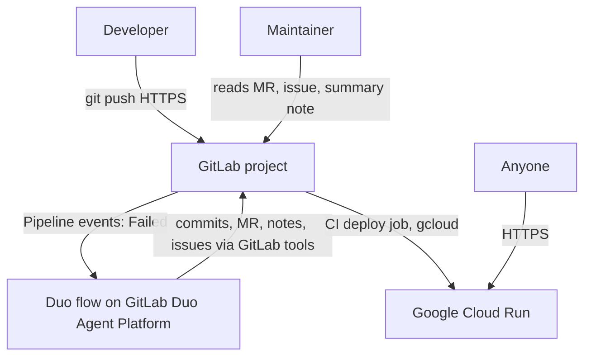
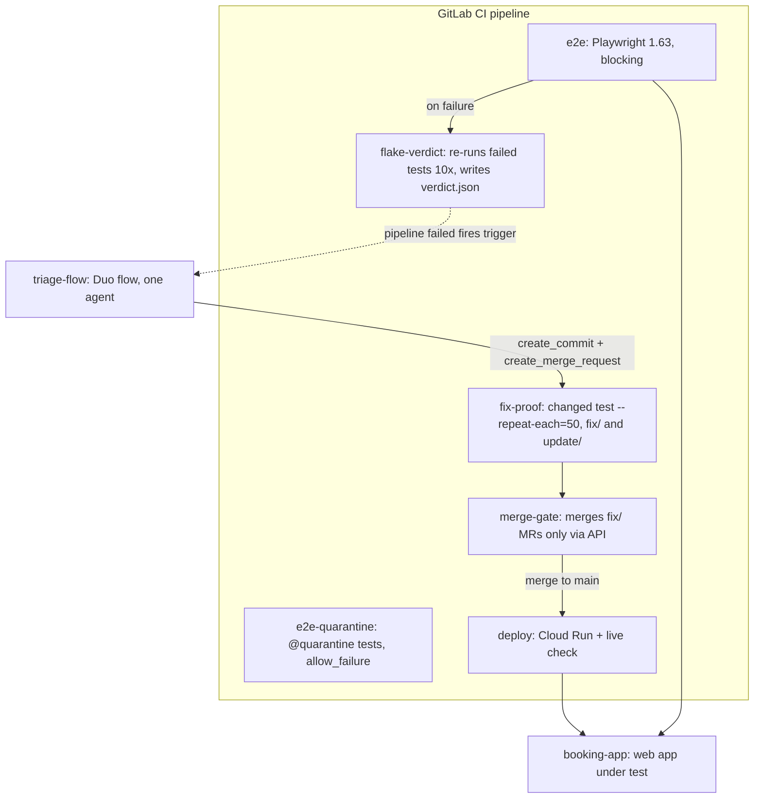

# <Product> — Architecture

**Status:** planned (describes the intended design; the README describes what is built) · **Date:** 2026-10-10, revised 2026-10-11 for R11–R14

## Summary
CI jobs decide (verdict, proof, merge, deploy) and the Duo flow diagnoses and writes the change; the trade-off is that the merge needs the author's personal access token held by CI, because the flow has no tool that merges and the author's Developer role cannot create a project access token.

## Drivers
| ID | Quality attribute | Scenario (source, stimulus, environment, response) | Measure | From |
|---|---|---|---|---|
| QA-01 | Functional correctness | A developer pushes a commit that really breaks booking; the e2e job fails; the verdict re-runs the failing test | 0 "flaky" verdicts on 10 of 10 seeded real regressions (a real regression fails 10 of 10 re-runs) | R1, R2 |
| QA-02 | Functional correctness | The flow proposes a fix for a test that still fails sometimes; the proof runs the fixed test 50 times | A fix that still fails 10% of runs passes the proof with probability 0.9^50 ≈ 0.5%; at 30% failure, ≈ 2e-8 | R4, R5 |
| QA-03 | Time behaviour | A pipeline fails on an e2e test on a shared small runner | Verdict available ≤ 15 min after the failure | R1 |
| QA-04 | Time behaviour | A fix MR is merged to main | App deployed and verified live ≤ 10 min after the merge | R6 |
| QA-05 | Accountability | Any action the flow takes (comment, MR, quarantine, issue) | 100% of actions link back to the pipeline id that started them | R3, R8 |
| QA-06 | Functional correctness | A test fails on every re-run; the flow reads the commit diff and message and picks one of regression, app change, environment, test data | Right cause in ≥ 11 of 12 runs (4 seeded scenarios × 3 runs); 0 merges from `update/` branches | R11, R12, R13, R14 |

## Constraints
| # | Constraint | Source | Confirmed? |
|---|---|---|---|
| C1 | Must use GitLab Duo Agent Platform agents or flows reacting to triggers | `docs/HACKATHON.md` § Required tech | yes |
| C2 | Code is MIT-licensed and new since 2026-10-05 (Path A) | `docs/HACKATHON.md`, `LICENSE` | yes |
| C3 | Only human actions fire flow triggers; pipelines started by the flow's service account do not | GitLab Duo Agent Platform triggers documentation; a retry through the API with the author's token did fire it (S1) | assumption for the non-human half: the design does not depend on it, it only explains why `fix-proof` needs S6 |
| C4 | The flow job does not see CI/CD variables, custom or predefined; context arrives only through the trigger payload | spike S2 (`SPIKE_VISIBLE=unset CI_PROJECT_ID=unset`) | yes |
| C5 | The flow has no tool that merges or enables auto-merge; `update_merge_request` only offers labels, assignees, reviewers, title, description, squash, target branch and `state_event: close` | spike S3 (issue #3) | yes |
| C6 | Deploy target is Google Cloud for the bonus | `docs/judging.tsv` "Google Cloud bonus" | yes; project `showcase-flaky`, spike S5 |
| C7 | CI variables and secrets live on this project only, never on the parent group | `CLAUDE.md` | yes |
| C8 | Deadline 2026-10-27 13:00 UTC | `docs/HACKATHON.md` § Timeline | yes |
| C9 | The flow has no tool that writes a note on a commit; it can create issues, issue notes and MR notes | GitLab `duo_workflow_service/components/tools_registry.py` lists only `GetCommitComments` for commits | yes; a real regression is reported in an issue |

## Options considered
| | C — the boring one: CI only | A — CI decides, Duo fixes | B — the flow does everything |
|---|---|---|---|
| What it looks like | `retry: 2` plus a script that tags a failing test as quarantined | CI jobs re-run, prove, merge and deploy; the flow reads the verdict, classifies, writes the fix or the quarantine, and waits on the MR pipeline | The flow re-runs the test, proves the fix and decides the merge inside its own job |
| Scenario it favours | QA-03, QA-04 | QA-01, QA-02, QA-05 | Fewest moving parts in the demo |
| Scenario it sacrifices | R3, R4, R7: no diagnosis, no fix, no agent | One more token (the merge token) and a longer pipeline | QA-02 and R4: the model would decide the merge, and the flow job has no Playwright browsers |
| What breaks first | Fails Stage One (no Duo Agent Platform) | The merge token expires or loses its role | A prompt change silently changes the merge rule |
| Cost to operate | CI minutes only | CI minutes + one flow session per red pipeline | Flow minutes for 60 test runs per failure |
| **Cost to exit** | Low, but it is not the product | Medium: the verdict and proof jobs are plain CI and survive dropping Duo | High: the logic lives in a prompt |

A is chosen: it is the only option where a deterministic job decides the verdict and the merge (R4) and Duo still does real work (R7). C loses Stage One; B makes the model the judge. settled: user-approved

## Chosen design

### Context


### Containers


### Components
| Component | Responsibility (one sentence) | Technology | Covers |
|---|---|---|---|
| `booking-app` | Small appointment-booking web app whose features carry natural flakiness sources (time zones, concurrent bookings, async confirmation, shared test data, animated modals) and one natural case of each deterministic cause (a redesign that renames the booking button, a CI time-zone setting, seed data that runs out) | Node web app, container image | R10 |
| `e2e-suite` | Playwright tests of the booking app, each source of flakiness and each deterministic cause covered by at least one test | `@playwright/test` 1.63.0, image `mcr.microsoft.com/playwright:v1.63.0-noble` | R10 |
| `flake-verdict` | When `e2e` fails, re-runs only the failed tests 10 times on the same commit and writes `verdict.json`, then fails the pipeline so the trigger fires | CI job, `needs: [e2e]` + `when: on_failure`; reads the failed tests' `file:line` from `e2e`'s JSON report and runs them with `--repeat-each=10`. Not `--last-failed`: combined with `--repeat-each` it runs each test once (measured 2026-10-10) | R1, R2, R8 |
| `triage-flow` | Reads the verdict; on `real` reads the commit diff and message and classifies the cause: regression → a "Real regression" issue; app change → an MR on `update/` that updates the test and waits for a human; environment → an `environment` issue; test data → a fix MR on `fix/` where the test sets up its own data; on `flaky` classifies the cause, commits a fix on a new branch, opens the MR, waits on its pipeline, and on a red proof replaces the fix with a quarantine and an issue | Duo Agent Platform custom flow (YAML v1, `ambient`), tools `gitlab_api_get`, `get_repository_file`, `create_commit`, `create_merge_request`, `create_issue`, `run_command`; definition in `.gitlab/duo/triage-flow.yml` | R2, R3, R5, R7, R11, R12, R13, R14 |
| `fix-proof` | In the pipeline of a flow MR from `fix/` or `update/`, runs each test the MR changes 50 times; any failure fails the job | CI job, `--repeat-each=50`; specs from `git diff` against the MR base | R4, R8, R12, R14 |
| `merge-gate` | Last job of a `fix/` MR's pipeline (never `update/`); when the proof passed, asks GitLab to merge the MR once its pipeline succeeds | CI job with `MERGE_BOT_TOKEN` (the author's personal access token, scope `api` only, masked, expires 2026-11-09) | R4 |
| `quarantine` | Keeps quarantined tests running without blocking: the blocking job skips `@quarantine`, a separate job runs them with `allow_failure: true` | Playwright `--grep-invert @quarantine` / `--grep @quarantine` | R5 |
| `deploy` | On main, deploys the app to Cloud Run, checks that the URL serves the booking page, and posts the run summary | CI job, `google/cloud-sdk:586.0.0-slim`, `gcloud run deploy --source`, `curl` content check; authenticates with Workload Identity Federation (GitLab `id_tokens` → pool `gitlab-pool`, restricted to this GitLab project → service account `gitlab-deploy`), so no Google key is stored anywhere | R6, R8 |

R7's stages map to: plan (issues), create (fix commit), verify (verdict, proof), release (merge-gate), configure (CI and flow YAML in the repo), monitor (live check, GitLab Observability traces of CI), govern (service account identity, token scope, quarantine expiry).

### Contracts
- **Trigger:** project trigger "Pipeline events → Failed" on `triage-flow`. `context:goal` is the pipeline webhook JSON (`object_attributes.id`, `ref`, `sha`, `status`, `user`, `builds[]`); `context:project_id` is the project id.
- **`verdict.json`** (artifact of `flake-verdict`, `expire_in: 30 days`):
  ```json
  {"pipeline_id": 0, "sha": "", "runs": 10,
   "tests": [{"file": "tests/e2e/booking.spec.ts", "title": "", "passed": 7, "failed": 3,
              "verdict": "flaky", "trace": "test-results/.../trace.zip",
              "error": "Expected: \"Booking confirmed\" Received: \"Booking pending\"",
              "error_at": "tests/e2e/booking.spec.ts:13"}]}
  ```
  `verdict` is `real` when `passed == 0` and `flaky` otherwise. A test that passes all `runs` re-runs is still `flaky`, because it already failed in `e2e`. `error` is the first failure message without ANSI codes, cut to 500 characters, and `error_at` is its `file:line`: the flow classifies from them because `gitlab_api_get` cannot read a job log, which is plain text and comes back empty (U4 run, MR !3). Read by the flow with `gitlab_api_get projects/:id/jobs/:job_id/artifacts/verdict.json` (spike S7).
- **`proof.json`** (artifact of `fix-proof`, `expire_in: 30 days`): the same shape as `verdict.json`, built by `tools/verdict.mjs` with `runs: 50`; readers use `passed` and `failed` and ignore `verdict`. It is missing when every changed test is tagged `@quarantine`, because then no test runs.
- **`e2e` on `fix/` and `update/` MRs** has `allow_failure: true`: the flakiness of other tests must not hold back a proven fix; there the gate is `fix-proof`. On `main` and other MRs `e2e` blocks.
- **Real regression issue:** title `Real regression: <title> (pipeline <id>)`, label `regression`, with the commit, `passed 0/<runs>` per real test, the pipeline URL, the verdict job id and the trace path; no branch or MR.
- **Flow branch:** `fix/<pipeline_id>-<test-slug>`; MR title `Fix flaky test: <title> (pipeline <id>)`; MR description starts with the cause class (`async-wait`, `concurrency`, `time-zone`, `shared-state`, `animation`, or `test-data` for R14) and the pass rate.
- **Commit evidence for `real`:** the flow reads `gitlab_api_get projects/:id/repository/commits/:sha` (message) and `.../commits/:sha/diff` (changed files and hunks). Rules of thumb in the prompt: the diff changes what the test asserts and the message says it on purpose → app change; only CI, config or dependency files changed → environment; the test reads data it never creates and the seed or a shared record changed → test data; otherwise regression.
- **App change MR:** branch `update/<pipeline_id>-<test-slug>`, title `Update test after app change: <title> (pipeline <id>)`, label `needs-review`; description quotes the commit message and the changed lines. `fix-proof` runs, `merge-gate` does not: a human merges or closes it.
- **Environment issue:** title `Environment change broke: <title> (pipeline <id>)`, label `environment`, naming the configuration file and setting the commit changed and the failing step; no branch or MR.
- **Quarantine:** the test title gets the tag `@quarantine`; the issue title is `Quarantined: <title>` with labels `flaky`, `quarantine`, the pass rates of verdict and proof, the trace links and `Expires: <date + 14 days>`.
- **Merge:** `merge-gate` calls `PUT /projects/:id/merge_requests/:iid/merge?auto_merge=true` with `MERGE_BOT_TOKEN`, only when `$CI_MERGE_REQUEST_SOURCE_BRANCH_NAME =~ /^fix\//`, so an `update/` MR can never merge itself. The merge is recorded as the author's, so the main pipeline that follows counts as human-started.
- **No verdict, no action:** the flow stops without acting when the failed pipeline has no `flake-verdict` job (a red main pipeline after a merge, a red deploy).
- **Summary:** one note on the original commit with the verdict, the MR, the proof result and the live URL.

### Data
Nothing persistent of its own. Evidence lives in GitLab: CI artifacts (`verdict.json`, Playwright traces, 30 days), MRs, issues and notes. The booking app keeps its bookings in memory; a restart resets them.

## Failure modes
| What fails | What happens | How it is detected | How it recovers |
|---|---|---|---|
| The model returns nothing (`finish_reason: content_filter`) | The flow session shows "Finished" with no action | No MR or note for a failed pipeline after 15 min; the GraphQL `duoWorkflowEvents` checkpoint shows 0 output tokens | A human retries the failed job, which fires the trigger again |
| `fix-proof` fails | The flow, still polling the MR pipeline, commits the quarantine on the same branch and opens the issue | `head_pipeline.status == failed` read by `gitlab_api_get` | The new pipeline skips the proof (no changed test outside quarantine) and `merge-gate` merges it |
| The flow times out while polling (timeout 900 s) | The MR stays open, red or green, with no merge | MR open > 30 min with label `flaky` | A human merges or closes; documented as a known limit |
| `MERGE_BOT_TOKEN` expired, revoked or with extra scopes | `merge-gate` fails (401 expired; 403 `insufficient_scope` was seen with a token that also carried `ai_workflows` and `mcp`) and the MR stays open | Red `merge-gate` job | Replace it with an `api`-only token in the project variables |
| Workload Identity Federation rejects the token (wrong audience, project id or pool) | `deploy` fails at `gcloud auth login` | Red `deploy` job | Check the `id_tokens` audience against the provider name |
| Cloud Run deploy or live check fails | Main pipeline red after the merge; it counts as human-started (the merge is the author's), so the flow starts, finds no `flake-verdict` job and stops | Red `deploy` job | Re-run the job by hand |
| A real regression is classified flaky | Prevented by construction: `flaky` needs at least one pass in 10 re-runs | QA-01 run on seeded regressions | — |
| A regression is classified as an app change | The flow opens an `update/` MR that would make the test accept the bug | QA-06 runs; the reviewer sees the commit message and changed lines quoted in the MR | Never merged automatically (`merge-gate` skips `update/`); the reviewer closes it and reverts the commit |
| A regression or environment change is classified as test data | A `fix/` MR changes how the test sets up data; the proof may pass and it merges | QA-06 runs; the MR description names `test-data` and the data it creates | The next red pipeline shows the regression again; documented as the residual risk of R14 |
| The commit diff cannot be read | The flow cannot classify a `real` failure | S8 | Falls back to a "Real regression" issue that says the diff was unavailable |

## Spikes
| ID | Assumption | Experiment | Success criterion | Result | Plan B |
|---|---|---|---|---|---|
| S1 | "Pipeline events → Failed" starts a custom flow in this group | flow `spike-hello` with that trigger; branch `spike/platform` with a job that runs `exit 1` | flow session created ≤ 5 min | passed: the flow pipeline starts about 3 s after the failure and its job takes 37–40 s | trigger by mention on the MR |
| S2 | What the flow job can see | `run_command` prints named variables; `curl` to gitlab.com | variables and network recorded | passed with a finding: CI variables are not visible (C4); network goes out through a proxy on `localhost:3128` and reaches gitlab.com | pass context through the payload (adopted) |
| S3 | The flow can leave its MR with auto-merge | flow opens MR !1 and calls `update_merge_request` | MR shows merge when pipeline succeeds | failed: the tool has no auto-merge option (C5); the MR itself was created and its pipeline ran | `merge-gate` CI job with a project access token (adopted; see S3b) |
| S3b | A CI job in the flow's MR pipeline can merge it with a token | `merge-gate` job on MR !2 (branch `fix/s3b-…`, opened by the flow) with `MERGE_BOT_TOKEN` | MR merged by the job | passed: the variable reaches pipelines started by the flow's service account; HTTP 200 and MR merged once its pipeline succeeded. A first token with `ai_workflows` and `mcp` scopes got 403 `insufficient_scope`; an `api`-only one works | the flow comments "proof passed" and a human merges |
| S4 | `--repeat-each=50` fits a small shared runner | job with the Playwright image and one test | ≤ 10 min | passed: 50 runs in 37 s; job 88 s in total | lower N using the QA-02 numbers |
| S5 | CI can deploy to Cloud Run | `spike-deploy` job: GitLab OIDC token → Workload Identity Federation → `gcloud run deploy --source` of a one-page container, then `curl` | URL serves the page | passed: `gcloud run deploy` took 44 s on the first deploy (job 89 s) and the URL served the page; no service account key was created | deploy elsewhere and lose the bonus |
| S6 | Someone reacts to a red proof without a human trigger | flow polls its MR with `run_command "sleep 30"` + `gitlab_api_get` | flow reads the final pipeline status | passed: one 30 s poll read the MR pipeline status both green (`success`, S3 run) and red (`failed`, S7 run) | run the 50 repetitions inside a CI job the flow cannot see (no reaction) |
| S7 | The flow can read `verdict.json` from the failed pipeline's job artifacts | `gitlab_api_get` on the artifact path | JSON parsed in the flow | passed: `gitlab_api_get projects/:id/jobs/:job_id/artifacts/verdict.json` returned the JSON; the job id came from the trigger payload with no extra call | `flake-verdict` prints the JSON as the last log line and the flow reads the job trace |
| S8 | The flow can read a commit's message and diff | `gitlab_api_get projects/:id/repository/commits/:sha/diff` in the first R11 run | JSON with `new_path` and `diff` per file | pending, not blocking: the same endpoint family already returned JSON for artifacts (S7) | the read-only `get_commit_diff` tool from the GitLab tool registry |

## Decisions
- [ADR-0001](adr/0001-ci-decides-duo-fixes.md) — CI jobs decide verdict, proof and merge; the Duo flow diagnoses and writes the change.

## Out of this design
- R9 (demo video under 3 min) is presentation work, covered by the record-video step, not by a component.
- Releasing a test from quarantine automatically, prediction of flakiness, multi-project runs: deferred in the BRIEF.
- Infrastructure flakiness (runner or registry outages): outside the product. The environment cause (R13) covers only configuration a commit changes in the repo.
